# Entity Relationship Diagram — PostgreSQL Schema

Generated from `packages/persistence/src/schema.ts`.

## Diagram

_Rendered ERD generated from the schema definition in `packages/persistence/src/schema.ts`._

## Table reference

| Table                               | Purpose                                                               | Key constraints                                                 |
| ----------------------------------- | --------------------------------------------------------------------- | --------------------------------------------------------------- |
| `reconciliation_job`                | Root entity — lifecycle state, period context, retry/failure metadata | —                                                               |
| `reconciliation_source_file`        | Bank or GL file registration and import metadata                      | UNIQUE `(job_id, source_system)`                                |
| `reconciliation_import_batch`       | Ingest batching ledger with row-range tracking                        | UNIQUE `(source_file_id, batch_number)`                         |
| `reconciliation_raw_row`            | Raw source rows exactly as parsed                                     | UNIQUE `(source_file_id, line_number)`                          |
| `reconciliation_canonical_row`      | Normalized rows with computed fields                                  | UNIQUE `(raw_row_id)`                                           |
| `reconciliation_match_group`        | Grouped multi-transaction match candidates                            | —                                                               |
| `reconciliation_match_result`       | One-to-one match/probable pairs with `MATCH` or `PROBABLE` bucket     | —                                                               |
| `reconciliation_rule_result`        | Traceable rule lineage per match result, match group, or exception    | `target_kind` ∈ `MATCH_RESULT`, `MATCH_GROUP`, `EXCEPTION_ITEM` |
| `reconciliation_exception`          | Final exception records with rule traces                              | —                                                               |
| `reconciliation_review_observation` | Generated high-level review notes                                     | —                                                               |
| `reconciliation_job_summary`        | Aggregate metrics and chart payloads                                  | PK is also FK (1-to-1 with job)                                 |
| `reconciliation_export`             | Workbook/JSON export metadata                                         | UNIQUE `(job_id, export_type)`                                  |
| `reconciliation_review_decision`    | Durable reviewer outcomes per target                                  | UNIQUE `(job_id, target_type, target_id)`                       |
| `reconciliation_audit_event`        | Full audit trail of every state transition and operation              | BIGSERIAL PK for insertion order                                |
| `schema_migrations`                 | Migration version tracking                                            | —                                                               |

## Cascade and nullability notes

- `reconciliation_source_file`, `reconciliation_import_batch`, `reconciliation_raw_row`, `reconciliation_canonical_row`, `reconciliation_match_group`, `reconciliation_match_result`, `reconciliation_rule_result`, `reconciliation_exception`, `reconciliation_review_observation`, `reconciliation_job_summary`, `reconciliation_export`, `reconciliation_review_decision`, `reconciliation_audit_event` all cascade delete from `reconciliation_job` (`ON DELETE CASCADE`).
- `reconciliation_match_result.bank_transaction_id`, `reconciliation_match_result.qbo_transaction_id`, `reconciliation_rule_result.candidate_transaction_id`, and `reconciliation_exception.canonical_row_id` are nullable with `ON DELETE SET NULL` — exception and match records survive canonical row deletion.
- `reconciliation_rule_result.target_id` and `reconciliation_review_decision.target_id` are polymorphic references (no enforced FK) — `target_kind` / `target_type` discriminates the referenced table.

## Migration history

| Version | Name                                                 |
| ------- | ---------------------------------------------------- |
| 1       | `create_reconciliation_persistence_tables`           |
| 2       | `add_foreign_keys_for_scalar_transaction_references` |
| 3       | `add_read_model_access_indexes`                      |
| 4       | `enable_pgaudit_extension_when_preloaded`            |
